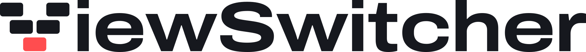
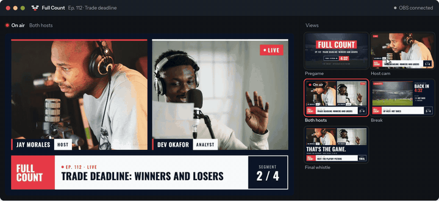
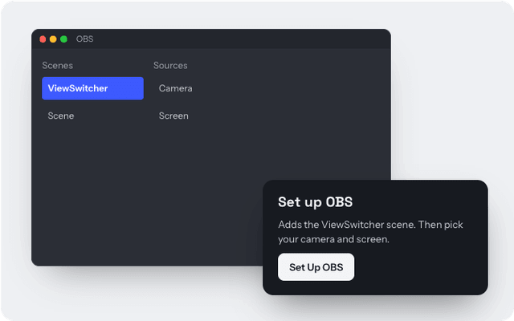
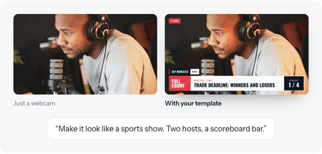
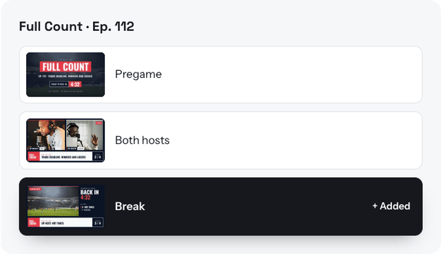
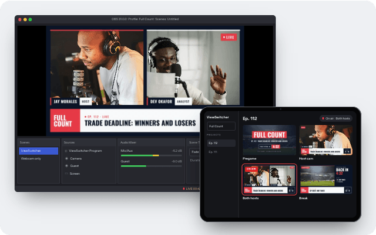
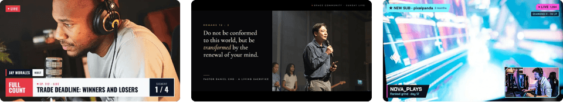

<p align="center">
  <a href="https://viewswitcher.com">
    <picture>
      <source media="(prefers-color-scheme: dark)" srcset="apps/site/public/brand/viewswitcher-logo-white.svg">
      
    </picture>
  </a>
</p>

<h1 align="center">Look professional when you go live.</h1>

<p align="center">The free, custom scene manager and one-click switcher for OBS on Mac.</p>

<p align="center">
  <a href="https://github.com/2witstudios/viewswitcher/releases/latest/download/ViewSwitcher.dmg"><b>Download for Mac</b></a>
  &nbsp;·&nbsp;
  <a href="https://viewswitcher.com">viewswitcher.com</a>
</p>

<p align="center">
  
</p>

## How it works

Set up your views once. Then every show is a click away, and OBS keeps streaming the way it always does.

### 1. Set up once

Download ViewSwitcher, open OBS beside it and click **Set Up OBS**. It adds what OBS needs; then you pick your camera and screen once. [Setup guide](https://viewswitcher.com/setup)



### 2. Create a custom template

Connect your favorite AI (Claude, Cursor, any app with MCP) in one click and describe the look you want. Or start from a [free template](https://viewswitcher.com/templates). Templates are small web pages, so you can also code your own with the [ViewSwitcher skill](apps/server/library-kit/skills/viewswitcher-scenes/SKILL.md).



### 3. Add it to your stream

Make a stream for this week's show and add the views you need. Retype this episode's titles right on the view; the template stays the same for next week.



### 4. Click to switch and control your live

Click a view on your Mac, or tap it on your iPhone or iPad. Hold the iPhone sideways and your views fill it like a deck. OBS cuts to it: your camera, screen share and titles move into place, and the stream keeps going.



## Free templates

Built in, or download more. Your show's name and colors fill in.

<a href="https://viewswitcher.com/templates"></a>

[Full Count](https://viewswitcher.com/templates/full-count) (sports podcast) · [NOVA_PLAYS](https://viewswitcher.com/templates/nova-plays) (gaming) · [Grace Community](https://viewswitcher.com/templates/grace-community) (church) · [Roam with Remi](https://viewswitcher.com/templates/roam-with-remi) (travel vlog) · [Riverside Live](https://viewswitcher.com/templates/riverside-live) (live events) · [Saltwater Kitchen](https://viewswitcher.com/templates/saltwater-kitchen) (cooking). [All templates](https://viewswitcher.com/templates)

## Connect your AI

In ViewSwitcher, **Edit with AI** connects Claude Desktop, Claude Code or Cursor in one click; any other app that supports MCP gets a setup line to paste. Then just ask: "Make a halftime screen with a 4-minute countdown." Your AI makes the view in your colors, checks a preview and fixes what's off, and everything it makes is a normal view you can edit on screen. You choose whether it can put views on air: never, only when you're not live (the default), or always. AI apps connect only on this Mac, and only to your show's folder. [More on viewswitcher.com/ai](https://viewswitcher.com/ai)

## Free on the Mac

No subscription, no watermark, and the templates are free. You need a Mac with macOS 14 or later (Apple silicon or Intel), [OBS](https://obsproject.com) (free) and a camera. [ViewSwitcher for iPhone and iPad](https://viewswitcher.com/ipad) is $9.99 once (one purchase for both), if you want one: coming to the App Store.

**[Download ViewSwitcher for Mac](https://github.com/2witstudios/viewswitcher/releases/latest/download/ViewSwitcher.dmg)**: open it, drag ViewSwitcher to Applications, and it sets up OBS for you the first time. It's notarized, and it keeps itself up to date. [Install steps and what's new](https://viewswitcher.com/download) · [Support](https://viewswitcher.com/support) · [Privacy](https://viewswitcher.com/privacy)

---

## For developers and self-builders

ViewSwitcher is open source under the [MIT license](LICENSE). Everything below is for running it from source, building on it, or making views by hand.

### Run from source

You need [Bun](https://bun.sh) and OBS.

```sh
bun install
bun run start            # builds the switcher, serves everything on http://localhost:7420
# or, while working on the app itself:
bun run dev              # server on :7420 (watch) + Vite on http://localhost:5173
bun run mac:dev          # builds the Mac app (Debug) and runs it, attached to the server above (or starting one from source)
```

Vite's dev server proxies `/api`, `/library` and `/ws` to the server and keeps the browser's Host (`apps/web/vite.config.ts`), so the dev page at `http://localhost:5173` is the server's own origin and its changes are accepted; no extra setting is needed. Another dev host needs its origin in `VIEWSWITCHER_ORIGINS`.

The library (your shows) is `~/ViewSwitcher Library` unless `VIEWSWITCHER_LIBRARY` says otherwise. The first run creates it with the agent skill and a first org, "My channel". Closing the Mac app's window keeps the server running for OBS and the iPhone or iPad; Quit (in the menu bar or ⌘Q) stops it.

<details>
<summary>Environment variables (all optional; the Mac app passes them through to its server)</summary>

| var | default |
|---|---|
| `VIEWSWITCHER_LIBRARY` | `~/ViewSwitcher Library` |
| `PORT` | `7420` |
| `HOST` | `127.0.0.1`. Loopback only: the server refuses to start with another address; the Wi-Fi setting is the way onto the network (below) |
| `VIEWSWITCHER_LAN` | `1` also listens on the Wi-Fi from the start (the Mac app passes its "Let Phones and Tablets on This Wi-Fi Connect" setting) |
| `VIEWSWITCHER_LAN_HOST` | `0.0.0.0`: the address the Wi-Fi listener binds (tests bind this Mac's LAN IP) |
| `VIEWSWITCHER_ADMIN_TOKEN` | set by the Mac app at each launch: the secret for the pairing endpoints (`/api/remote…`); unset, they answer 404 |
| `OBS_URL` / `OBS_PASSWORD` | `ws://127.0.0.1:4455` / read from OBS's own settings on this Mac |
| `OBS_SCENE` / `OBS_PROGRAM_SOURCE` / `OBS_GROUND_SOURCE` | `ViewSwitcher` / `ViewSwitcher Program` / `ViewSwitcher Ground` |
| `OBS_DEVICES` | `Camera,Screen,iPad`: sources a scene can place. A view hides each of these that it has no slot for, and also any other source a view has ever placed (a Guest or Camera 2 box; remembered in `.viewswitcher/state.json`). Every other item in the scene (a mic, music, a watermark) and the program and ground sources are never touched. |
| `VIEWSWITCHER_EDITOR` | app for "Open the file", e.g. `Cursor` (default: your text editor) |
| `VIEWSWITCHER_LOG` | `1` prints requests, placements and OBS-browser errors |
| `VIEWSWITCHER_USB` | `0` turns off the USB-C bridge |
| `VIEWSWITCHER_WEB_DIST` / `VIEWSWITCHER_STARTER` / `VIEWSWITCHER_LIBRARY_KIT` | `apps/web/dist` / `apps/server/starter` / `apps/server/library-kit` (the Mac app points these into its Resources) |
| `VIEWSWITCHER_UPDATES` | Mac app: `0` turns off checking for updates |
| `VIEWSWITCHER_VERSION` | set by the Mac app to its version, which the Claude Desktop extension carries (default `1.0.0`) |
| `VIEWSWITCHER_REPO` | Mac app, Debug builds without a bundled server: run `bun <repo>/apps/server/src/index.ts` (set by `mac:dev`) |
| `VIEWSWITCHER_ORIGINS` | extra addresses the switcher is reached at, e.g. `http://192.168.1.20:7420` (comma-separated). The server answers only to this Mac's loopback names, `*.ts.net`, and (while Wi-Fi is on) this Mac's own `<name>.local` and LAN addresses, and takes changes only from a page at exactly its own origin or one listed here |

</details>

### OBS setup

1. OBS → Tools → WebSocket Server Settings: enable it.
2. In the switcher, press **Set up OBS** on the card at the top (or, from source, `bun run obs:setup`). This creates the scene, the program browser source and the ground color, and switches OBS to the scene.
3. Add your devices to the "ViewSwitcher" scene with these exact names: **Camera** (video capture), **Screen** (macOS Screen Capture), **iPad** (the iPad over USB as a video capture device). The card lists the ones still missing.
4. Press **Set up OBS again** to put the browser source back on top. The card goes away once everything is there.

```
OBS scene "ViewSwitcher"
├─ ViewSwitcher Program   browser source → http://127.0.0.1:7420/program   (top)
├─ Camera · Screen · iPad                                                 (moved per scene)
└─ ViewSwitcher Ground    color source, set to the on-air org's ground     (bottom)
```

If a scene asks for a slot whose OBS source doesn't exist, the switcher shows a warning. **If scenes don't show in OBS** (the program source stays blank, even for a normal web page), turn off OBS → Settings → Advanced → Sources → "Enable Browser Source Hardware Acceleration" and restart OBS. On macOS 26 with OBS 32.1, OBS's embedded browser never starts with it on.

### How a view works

A view (a scene) is a 1920 × 1080 HTML page with a transparent background. Boxes marked `data-slot` are where OBS sources go:

```html
<main class="scene">
  <div class="slot" data-slot="Screen" style="left: 32px; top: 32px; width: 1472px; height: 828px"></div>
  <div class="slot" data-slot="Camera" style="left: 1528px; top: 32px; width: 360px; height: 450px"></div>
  <footer class="abs panel" style="left: 32px; top: 884px; width: 1856px; height: 164px">
    <span class="kicker">{{ORG_NAME}}</span>
    <h2 class="display">Today's topic</h2>
  </footer>
</main>
```

OBS shows one browser source, `/program`, which displays the view on air. When you switch, the server moves and crops the OBS sources named in the view's slots (`Camera`, `Screen`, `Guest`, `iPad`…) into their boxes over obs-websocket, and paints the org's ground color behind everything. Text lives in its own small elements, so people can retype it in the switcher's editor; the format, the transition contract and the rules for agents are in the [viewswitcher-scenes skill](apps/server/library-kit/skills/viewswitcher-scenes/SKILL.md).

**Transitions** are pages too. Switching briefly covers the screen with the scene's transition page: for a template set's view, the set's own `_shared/transition.html`; for a project's scene, the project's `transition.html` if it has one; else the org's `templates/_shared/transition.html`; else (the default) a blank fade through the ground color.

Scenes run sandboxed: every library page is served with a CSP sandbox and shown in sandboxed frames, so a scene's scripts (an agent's, or a stranger's template pack) can't reach the switcher's API. The program page reads slot positions through a small bridge over `postMessage` ([docs/template-packs.md](docs/template-packs.md#scripts-and-the-sandbox)).

### The library

```
~/ViewSwitcher Library/            (its own git repo; VIEWSWITCHER_LIBRARY)
├─ my-channel/  church/  podcast/  …   one folder per org (a brand or channel)
│  ├─ org.json                     { name, accent, ground }
│  ├─ BRAND.md                     the org's brand rules, for agents
│  ├─ templates/*.html, templates/_shared/{theme.css, scene.js, transition.html, brand/mark.svg}
│  ├─ templates/<set>/              a template set installed from a template pack: pack.json, views, _shared/, assets/
│  ├─ assets/
│  └─ projects/<project>/{project.json, transition.html?, scenes/*.html, streams/<MM-DD-slug>/*.html}
└─ .claude/skills/viewswitcher-scenes/SKILL.md     from apps/server/library-kit (changes ship there)
```

- **Orgs**: one library holds any number of orgs, each with its own templates, assets, projects and brand. New orgs come from the org menu in the sidebar, starting from a built-in template set or `apps/server/starter/` (neutral templates in the org's name and accent color).
- **Projects and streams**: a project is a series with shared scenes; a stream is one dated episode that can override any of them.
- **Templates** are starting points that never go on air; scenes are made from them.

### Template packs

A template pack is a whole look in one folder or `.zip`: `pack.json`, `templates/*.html`, `_shared/` and `assets/`. Drop one on the Templates page and it installs as its own template set, filled with the org's name and colors. Seven come built in (the starter and the site's six example shows): pick them for a new org, or with **Add templates**. The format, its limits and the validator: [docs/template-packs.md](docs/template-packs.md).

`bun run packs:export` writes the starter kit and the site's six example shows as template packs, the same ones the app has built in (`dist/packs/<id>.zip`). The site builds and validates the downloadable ones at [viewswitcher.com/templates](https://viewswitcher.com/templates) the same way.

### MCP for developers

ViewSwitcher is an MCP server for the AI agent you already use. **Edit with AI** (in the switcher's header, and in the Mac menu bar) connects one and shows whether one is connected.

- **Endpoint:** Streamable HTTP at `http://127.0.0.1:7420/mcp` (stateless, JSON responses). Only this Mac itself may use it (a `mac` route, `isMac` in `apps/server/src/gate.ts`): a loopback connection to a loopback host, with no proxy headers and no other page's `Origin`, and not the USB-C iPad. A phone or tablet paired over Wi-Fi still gets 404 here, as do `/api/info`, `/api/agent/clients` and the Claude Desktop extension.
- **stdio**, for clients that only launch commands: `/Applications/ViewSwitcher.app/Contents/Helpers/viewswitcher-server --mcp-stdio --port 7420` (from source, `bun apps/server/src/index.ts --mcp-stdio --port <port>`; `VIEWSWITCHER_PORT` works too, `PORT` is ignored). It relays to the running switcher and never starts a second one; it opens the app if nothing answers, and never sends a call twice.
- **Port 7420:** the library's `.mcp.json`, `.cursor/mcp.json` and `AGENTS.md` name it, as the Mac app always uses it. On another port, Edit with AI gives the address to add instead.
- **Connecting:** the library has `.mcp.json` (Claude Code, which asks once to allow it), `.cursor/mcp.json` and `AGENTS.md` (with the Codex snippet). Edit with AI adds a per-install Claude Desktop extension (`.mcpb`), a Cursor install link, and the URL, stdio command and Codex TOML for the rest.
- **Tools:** `get_state`, `list_orgs`, `scan_library`, `list_files`, `read_file`, `get_guide` to read; `preview_scene`, `see_program` to look; `write_file`, `add_asset`, `list_template_sets` / `add_template_set`, `create_project`, `create_stream`, `scene_from_template`, `customize_scene`, `revert_scene`, `duplicate_scene`, `rename_scene`, `customize_transition`, `revert_transition` to change; `go_on_air`. Paths start with the org id; writes to an existing file need the hash from `read_file`, as in the switcher's editor.
- **Previews:** `preview_scene` renders a library scene in OBS, in a muted "ViewSwitcher Preview" scene that's never switched to, and returns the picture; `see_program` returns what OBS is putting out, camera and screen included. Without OBS, they return the scene's preview URL instead.
- **On air:** the agent setting (Edit with AI on the Mac; `.viewswitcher/settings.json`) says what agents may put on air: **Never**, **When not live** (the default: not while OBS is streaming or recording, and no changes then to the scene on air, its transition, the org's shared files or anything the scene loads) or **Always**. It limits agents' MCP tools only, never people in the switcher. It steers agents that use the tools; it isn't a security boundary: an agent with plain file access to the library is outside it. Scenes can't get around it: they run sandboxed, so their requests to the switcher's API are refused.

### Phones and tablets over Wi-Fi

Off by default. In the Mac app's menu, **Let Phones and Tablets on This Wi-Fi Connect** opens a second listener on the network (announced over Bonjour); **Phones and Tablets…** shows a one-time code, its QR code and the paired devices. The iPhone and iPad app pairs from its own connector (Scan reads the QR code with the app's camera; Enter code finds the Mac over Bonjour and opens its pair page); any phone's browser can pair by opening the QR code's link.

The security model in short: a request counts as "this Mac" only if its socket is loopback, its Host is a loopback name and it carries no proxy headers (the Mac app, browsers on the Mac, OBS's program page and the USB-C iPad, whose tunnel ends on 127.0.0.1). Everything else needs a paired device token, or it gets the pairing page and 401 for everything else; and with the setting off, everything else is refused (403), paired or not. Each route in `apps/server/src/http/routes.ts` says who it's for; one that says nothing is this Mac's only. Changes must come from exactly the page's own origin with a JSON body. Pairing codes are 8 characters, single use and last 5 minutes, with guesses rate-limited per address and a code cancelled after 10 wrong tries. Device tokens are 32 random bytes in an `HttpOnly; SameSite=Strict` cookie, refreshed with use and valid for 400 days from last use; only their SHA3-256 hash is kept (`<library>/.viewswitcher/devices.json`, 0600). Removing a device stops its token and closes its socket at once. The pairing endpoints answer only this Mac with the secret the app started the server with, so a paired phone can't mint codes or remove devices. Known limit: Wi-Fi traffic is plain HTTP, so the setting says to use it on networks you trust, like home or church Wi-Fi. Details are in `apps/server/src/gate.ts`, `http/dispatch.ts` and `pairing.ts`.

**Developer-only: `tailscale serve`.** A `*.ts.net` address forwarded to the switcher counts as a remote device: it pairs like a phone, and only while **Let Phones and Tablets on This Wi-Fi Connect** is on. Turning that off cuts tailnet devices off too.

On a phone the switcher is a remote, in the app or a browser. Sideways (a short touch screen up to 1000 px wide) it's a deck: the scenes four across under one slim bar (the stream, on air, REC, LIVE), with the library sliding in from the title. Upright (≤ 600 px) the scene on air shows large above the scenes. Adding and editing scenes, the transition and OBS setup stay on the Mac and iPad.

### The Mac, iPhone and iPad apps

`apps/apple` is one Xcode project, generated from `project.yml` with XcodeGen: ViewSwitcher.app for macOS, ViewSwitcher for iPhone and iPad (one universal app), and the shared ViewSwitcherKit. Building, signing, entitlements and tests are in [apps/apple/README.md](apps/apple/README.md).

The Mac app is a native window (WKWebView) and menu-bar item around the server, which is compiled with `bun build --compile` into `Contents/Helpers/viewswitcher-server`, next to the built switcher, the starter kit, the library kit and the built-in template packs in `Contents/Resources`. If a ViewSwitcher server already answers on `PORT`, the app uses it instead of starting its own, and never stops a server it didn't start.

```sh
bun run mac:build              # apps/apple/build/ViewSwitcher.dmg (universal) + appcast.xml, signed with the Developer ID in your keychain
bun run mac:build --app        # just apps/apple/build/export/ViewSwitcher.app, then:
bun run mac:e2e                # drives the built app on port 7435 with OBS offline and USB off
bun run mac:release            # signed, notarized and stapled (needs a notarytool keychain profile)
bun run mac:release --publish  # ...and uploads it to a draft GitHub release for a person to publish
bun run ipad:deploy            # build, sign, install and launch the app on the plugged-in iPad, else iPhone
```

Updates use Sparkle: the app reads `appcast.xml` from the latest GitHub release, signed with an EdDSA key. The dmg is named `ViewSwitcher.dmg` because the site links to `releases/latest/download/ViewSwitcher.dmg`.

**The iPhone and iPad over the cable:** iOS gives apps no network over the cable; the only path is usbmuxd, and it only connects Mac → device. The server (`apps/server/src/usb-bridge.ts`) keeps a few idle tunnels open to the app on iPad port 7421, and the app (`apps/apple/iPad/UsbTunnel.swift`) serves `127.0.0.1:7420` on the iPad and pipes each web view connection through one of them. So the app simply loads the real switcher, served over the cable; a "USB" pill confirms it. Without the cable, the app pairs over Wi-Fi from its connector: Scan reads the Mac's pairing QR code with the app's own camera (the system Camera would pair Safari instead), and Enter code finds the Mac by Bonjour; the connector then remembers that address. An iPhone works the same way (iPhone 15 and later over USB-C). (Developer-only: a `tailscale serve` address works the same way while the Wi-Fi setting is on; the user-facing copy doesn't mention it.)

### Repo layout

```
apps/server            Bun server: API, library + watcher, orgs, live state, OBS placement and setup, USB bridge, Wi-Fi pairing
apps/server/src/mcp    the MCP server for agents (/mcp and --mcp-stdio)
apps/server/starter    the starter kit copied into each new org
apps/server/library-kit  what a new library starts with: the agent skill, CLAUDE.md, AGENTS.md, MCP configs, .gitignore
apps/web               Vite + React + TanStack Router/Query SPA: the switcher, the editor and /program
apps/apple             one Xcode project (XcodeGen): the Mac app, the iPhone and iPad app, ViewSwitcherKit
apps/site              viewswitcher.com (Astro); see apps/site/README.md
packages/shared        types and pure, dependency-free logic (resolveStream, coverTransform, obsColor, the scene scanner, the template pack validator)
docs                   template-packs.md, screenshots
.github                CI (tests, typechecks, swift test), Dependabot, the PR template
```

### Tests and typechecks

```sh
bun test                                                         # shared logic, server, usbmux, path safety, library kit, template packs, OBS setup, the site
bun run typecheck                                                # apps/web (app and tests), apps/server, packages/shared (with its tests)
cd apps/site && bun run check                                    # astro check
```

CI (`.github/workflows/ci.yml`) runs all of these, plus the switcher build and ViewSwitcherKit's `swift test`, on every pull request and push to main, with the Bun version in `.bun-version`. The Apple apps have XCTest (`xcodebuild test`, see [apps/apple/README.md](apps/apple/README.md)); `bun run mac:e2e` drives the built Mac app.

### What's next

- An ink layer: Pencil drawing from the iPad as a layer in `/program`.

### Contributing

See [CONTRIBUTING.md](CONTRIBUTING.md). Agents working in this repo: [AGENTS.md](AGENTS.md).

### License

[MIT](LICENSE) © 2026 2witstudios
